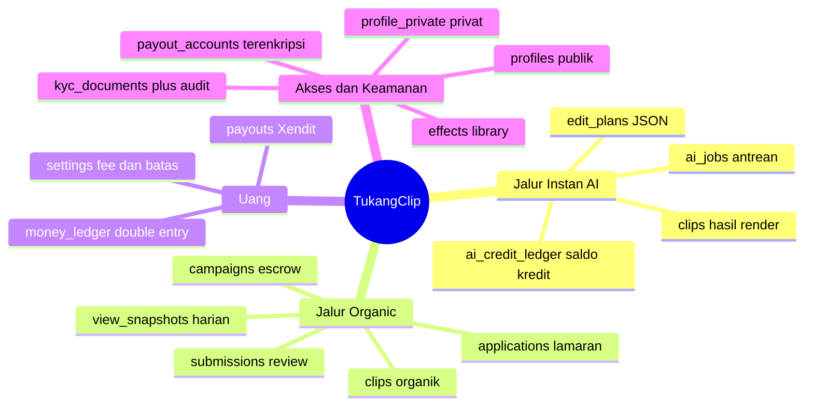
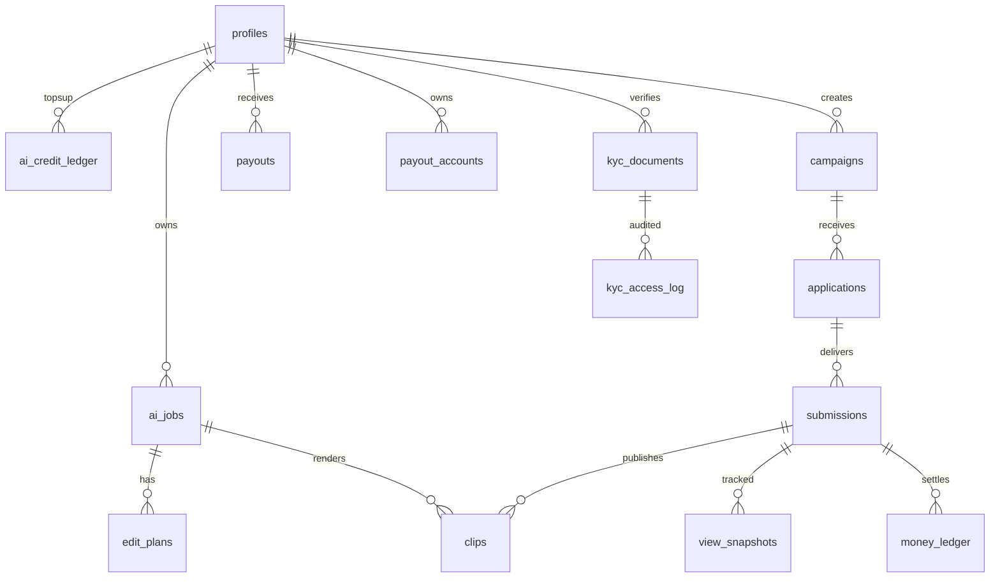

# Peta Database TukangClip

Sumber kebenaran: file SQL di `supabase/migrations/`. Dokumen ini hasil baca
plus ringkasan manual. File `DATABASE_MAP.generated.md` dibuat mesin dari SQL,
jangan edit manual.

Cara ubah database agar konteks tetap terbaru:
1. Ubah atau tambah file di `supabase/migrations/` (jangan ubah langsung di
   dashboard kecuali darurat).
2. Kalau darurat ubah di dashboard, tuang hasilnya jadi file migrasi baru.
3. Jalankan `npm run db:map`.
4. Commit file SQL plus `DATABASE_MAP.generated.md` bersamaan.
5. CI `db-map-check` gagal bila generated tidak sinkron.

## Mindmap konteks

## Relasi inti

## Alur status

- Submission: `draft -> submitted -> approved -> posted -> tracking -> paid_out`.
- Kampanye: `draft -> open -> closed -> done`, escrow `pending -> locked -> released/refunded`.
- Job AI: `queued -> transcribing -> analyzing -> rendering -> done/failed`.
- Payout: `queued -> processing -> succeeded/failed`.

## Batas penting

- Editor tidak punya relasi ke `ai_credit_ledger`.
- `money_ledger` selalu berpasangan per `group_id` (satu debit, satu kredit).
- Maks 3 proyek aktif per editor (`applied` plus `accepted`), SLA 72 jam.
- Ganti rekening me-reset `is_verified`. Email notifikasi dari backend.
- `role` dan `level` tidak bisa diubah sendiri.

## Kamus tabel ringkas

| Tabel | Isi | Baca klien |
|---|---|---|
| profiles | publik, role, level editor | semua login baca, ubah milik sendiri |
| profile_private | nama, HP | pemilik saja |
| payout_accounts | referensi rekening terenkripsi | pemilik saja |
| kyc_documents | kunci file KTP, status | pemilik baca status |
| kyc_access_log | audit buka file | service role saja |
| ai_credit_ledger | mutasi kredit AI | via backend |
| ai_jobs | antrean video | pemilik job |
| edit_plans | JSON versi per job | pemilik job |
| campaigns | budget escrow, rate, cap | open dibaca semua login |
| applications | lamaran editor | pelamar dan kreator kampanye |
| submissions | file editor dan status review | kedua pihak |
| clips | hasil jadi AI atau organik | pihak terkait |
| view_snapshots | views harian per platform | kedua pihak |
| money_ledger | debit kredit escrow fee payout | via backend |
| payouts | disbursement Xendit | editor pemilik |
| effects | id efek valid untuk LLM | semua login baca |
| settings | fee, batas, SLA | semua login baca |

Detail kolom dan policy per file SQL ada di `DATABASE_MAP.generated.md`.
